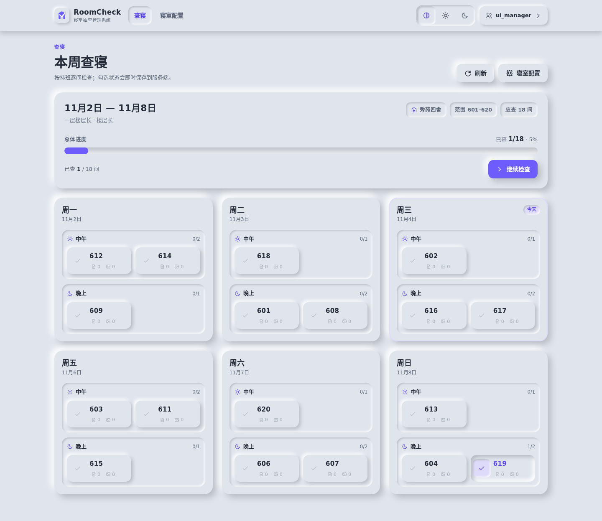
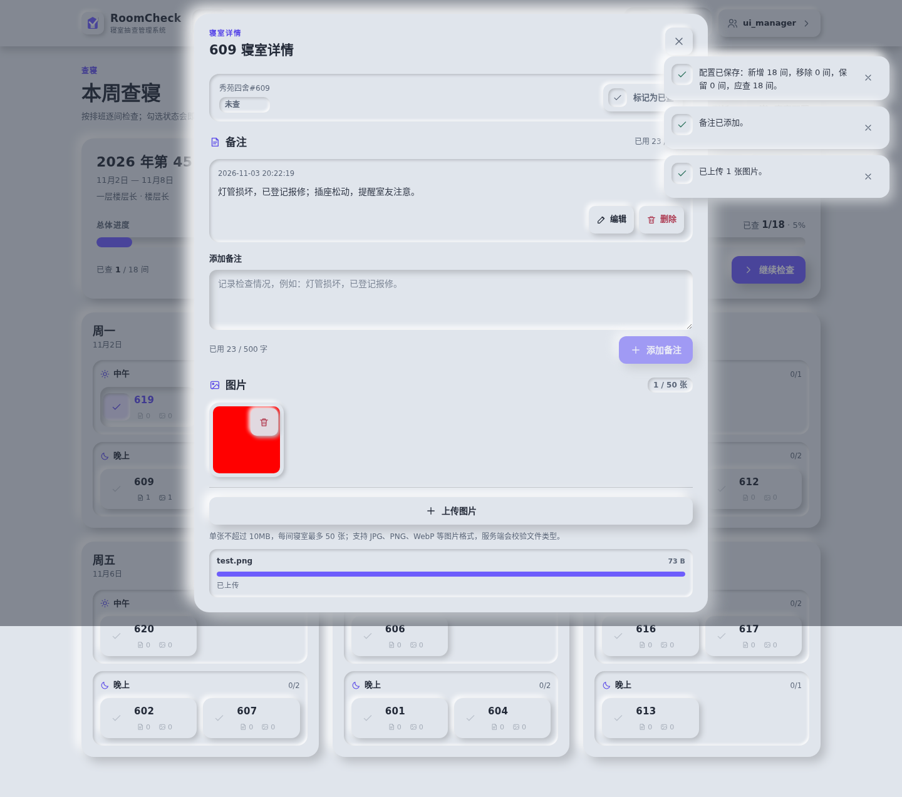
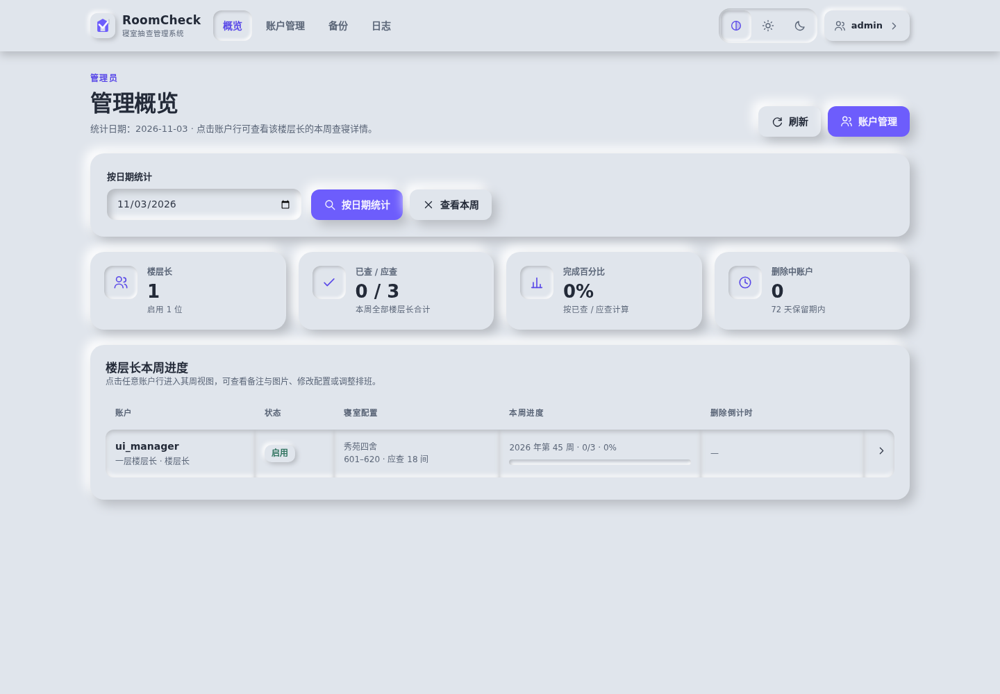
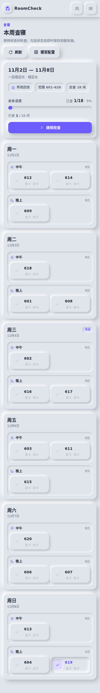

# RoomCheck · 寝室抽查管理系统

基于 **C 语言 + SQLite + 原生 HTML/CSS/JavaScript** 的寝室抽查管理系统。后端为单文件可执行程序，前端为新拟物（Neumorphism）风格单页应用，支持 Docker 多架构部署与 Linux musl 完全静态二进制交付。

- Docker Hub：`ArcticFox520/RoomCheck`（镜像引用为全小写 `arcticfox520/roomcheck`，由 CI 发布）
- 二进制目标：Linux musl static `amd64` / `arm64`
- 时区：`Asia/Shanghai`（UTC+8，无夏令时）
- 版本：1.0.0

---

## 1. 功能

### 账户与安全
- 三种角色：超级管理员（`super_admin`）、管理员（`admin`）、楼层长（`floor_manager`）；权限全部由服务端校验。
- 超级管理员首次启动自动创建并输出一次性凭据，首次登录强制改密；`ADMIN_RESET=1` 可重置超级管理员密码且不影响楼层长数据。旧版本升级时，原初始化管理员自动迁移为超级管理员，保留账户 ID、用户名、密码哈希与全部业务数据。
- 超级管理员拥有管理员的全部业务权限，并可创建、修改、启用、禁用、删除管理员账户，以及将服务器备份导出到本地。
- 管理员保留原有楼层长管理权限，不能管理管理员账户、不能访问超级管理员接口与备份导出接口。
- 楼层长账户：创建、修改、启用、禁用、删除；账户名全局唯一（数据库唯一索引）。
- 管理员与楼层长删除后立即禁止登录并进入 **72 天倒计时**，期间数据完整保留，可撤销删除；期满后台自动永久删除。系统禁止禁用或删除最后一个可用超级管理员。
- 加盐 PBKDF2-HMAC-SHA256 密码哈希；Session 7 天；服务端 Session + CSRF Token；同账户连续 5 次密码错误锁定 10 分钟（仅内存计数，重启清零）。
- 管理员与楼层长数据隔离；管理员查看备注、查看原图、修改楼层长数据均写入审计日志。
- 图片上传三层校验：扩展名黑名单、MIME 黑名单、文件签名（可执行文件/脚本/压缩包/HTML/SVG 等拒绝）。
- 响应头包含 CSP、`X-Content-Type-Options`、`X-Frame-Options` 等；前端不使用内联脚本。

### 寝室配置与排班
- 楼栋 + 起止寝室号生成寝室集合；无需查寝寝室校验（范围、重复、N>0）。
- `N = 原始总数 - 无需查寝数`，服务端计算并校验。
- 自然周（周一至周日），查寝日为周一、二、三、五、六、日，**周四完全隐藏**。
- 每天中午、晚上两组；六天平均分配、组内平均分配，余数随机。
- 范围变更采用**增量排班**：保留寝室日期/时段/勾选不变；移出寝室产生空位；新增寝室优先随机填空位，多余的新增寝室平衡分配到轻载日期/时段。
- 每次排班保存前校验：总数 = N、无重复、无遗漏、无周四，保留寝室位置不变；校验失败回滚。
- 主动重新生成（二次确认，清空勾选）；开始新一周（二次确认，迁移备注图片、清空排班勾选）。

### 查寝与备注图片
- 周标题按真实周起止日期显示（如 `11月2日 — 11月8日`，跨月/跨年同样按上海时区日期展示）。
- 顶部整体进度、已查 X/N、百分比；已勾选内凹卡片；今天高亮；继续检查定位第一个未勾选寝室。
- 勾选状态服务端持久化，刷新/重启/跨周保留；撤销勾选必须二次确认。
- 每间寝室多条备注，单寝室合计 ≤500 字。
- 每间寝室最多 50 张图片，单文件 ≤10MB，原图存储于数据卷，可查看原图（管理员查看记录“查看原图”审计）。
- 删除备注可级联删除关联图片（通过上传时的 `note_id` 关联）。

### 备份与审计
- 每日 03:00（上海）自动备份 SQLite + 图片目录，保留最新 3 份；备份失败仅记录 WARNING，5 分钟后重试。
- 管理员可手动备份与恢复；恢复前自动创建快照，校验备份完整性，恢复失败自动回滚；恢复后全部会话失效。
- 超级管理员可将指定备份导出为本地 `.tar` 文件（含数据库、图片与清单），导出前校验数据库完整性、清单 SHA-256 与图片完整性。
- 操作日志覆盖登录、账户管理、配置、随机排班、勾选、备注、图片、重置、备份、备份导出、永久删除等；按自然周清理（周一 00:00 边界）。

### 界面
- 新拟物：双阴影、同色系、左上高光/右下阴影、外凸/内凹、按下变内凹、无位移、Hover 阴影减小、输入框内凹、Focus 减少内阴影。
- 自动/亮色/暗色主题；桌面与移动端适配；触控区域 ≥44px；无孤儿 CSS。

---

## 2. 快速开始（Docker Compose）

```bash
# 从源码构建并启动（默认 8080 端口，数据保存在命名卷 roomcheck-data）
docker compose up -d --build

# 或使用 CI 发布的镜像
# docker compose up -d

# 首次启动查看管理员一次性凭据
docker compose logs roomcheck | sed -n '/管理员账户已初始化/,+5p'
```

访问 <http://localhost:8080>，使用日志中的管理员账户登录，系统会强制修改密码。
若希望在首次初始化时指定密码，可设置环境变量：

```bash
ADMIN_INIT_PASSWORD='YourStrongPassword' docker compose up -d
```

重置管理员密码（不影响楼层长数据）：

```bash
ADMIN_RESET=1 docker compose up -d
docker compose logs roomcheck | sed -n '/管理员账户已重置/,+5p'
# 记录凭据后，去掉 ADMIN_RESET 环境变量重新 up -d
```

### 直接使用镜像

```bash
docker run -d --name roomcheck \
  -p 8080:8080 \
  -v roomcheck-data:/data \
  -e ADMIN_INIT_PASSWORD='YourStrongPassword' \
  arcticfox520/roomcheck:1.0.0
```

> 生产环境请使用固定版本或 SHA Tag，禁止使用 `main`；容器只提供 HTTP，HTTPS 由外部反向代理终止。使用 HTTPS 时设置 `ROOMCHECK_COOKIE_SECURE=1`。

---

## 3. 本地构建与运行

### 依赖（Debian/Ubuntu）

```bash
sudo apt-get install build-essential musl-tools
```

### 开发构建

```bash
make dev
ADMIN_INIT_PASSWORD='Admin#12345' PORT=8080 ./build/RoomCheck
```

> 在 `dev` 与 `static` 构建之间切换时请先执行 `make clean`，避免复用另一架构的中间产物。测试脚本会自动 clean + 重建。

默认数据目录 `./data`（包含 `roomcheck.db`、`uploads/`、`backups/`），默认前端目录 `./frontend`。

### 环境变量

| 变量 | 默认值 | 说明 |
|---|---|---|
| `PORT` / `ROOMCHECK_PORT` | `8080` | HTTP 监听端口 |
| `ROOMCHECK_DATA_DIR` | `./data` | 数据根目录 |
| `ROOMCHECK_DB_PATH` | `<DATA_DIR>/roomcheck.db` | SQLite 路径 |
| `ROOMCHECK_UPLOAD_DIR` | `<DATA_DIR>/uploads` | 图片目录 |
| `ROOMCHECK_BACKUP_DIR` | `<DATA_DIR>/backups` | 备份目录 |
| `ROOMCHECK_WEB_ROOT` | `./frontend` | 前端静态资源目录 |
| `ADMIN_INIT_PASSWORD` | 随机 14 位 | 首次创建管理员时使用 |
| `ADMIN_RESET` | 未设置 | `1` 时启动重置管理员密码 |
| `ROOMCHECK_COOKIE_SECURE` | 未设置 | `1` 时 Cookie 增加 `Secure` |
| `ROOMCHECK_DISABLE_BACKUP` | 未设置 | `1` 时关闭每日自动备份（测试用） |
| `ROOMCHECK_DISABLE_SCHEDULER` | 未设置 | `1` 时关闭后台调度（测试用） |

### 测试

```bash
make test
```

测试脚本会自行启动/停止服务、使用临时数据目录，覆盖 29 组端到端用例（三种角色与权限边界、管理员账户管理、超级管理员保护、CSRF、锁定、Session、升级迁移、配置、N、排班、增量、勾选、备注、图片、重置、禁用、删除/撤销/到期永久删除、备份恢复、备份导出、周日期范围、自动备份、日志保留等）。

真实后端 + Playwright 的 UI 冒烟测试覆盖超级管理员首次改密、管理员账户管理、普通管理员权限隐藏、创建楼层长、配置范围、周日期范围（含跨年/刷新）、备份导出下载、暗色主题、移动端、管理员周视图、备份与日志页面。

### 静态二进制

```bash
# amd64（需要 musl-gcc，Debian 的 musl-tools 提供）
scripts/build-musl.sh amd64

# arm64（需要 aarch64-linux-musl-gcc，或在 arm64 容器内构建）
scripts/build-musl.sh arm64

file dist/linux-amd64-musl/RoomCheck
ldd dist/linux-amd64-musl/RoomCheck   # 输出 not a dynamic executable
```

构建脚本调用 `scripts/verify-static.sh` 校验 ELF 架构、`INTERP`、`NEEDED` 与动态依赖。

---

## 4. 目录结构

```text
RoomCheck/
├── backend/src/          # C 后端（HTTP、认证、配置、排班、查寝、备注、图片、生命周期、备份、调度）
├── frontend/             # index.html + css/style.css + js/api.js + js/app.js + assets/
├── database/schema.sql   # SQLite Schema 参考（运行时由后端内嵌执行）
├── docs/                 # API、需求、Agent 工作流、验收、限制、工程决策
├── tests/                # Python 端到端测试
├── scripts/              # musl 构建、静态验证与前端静态检查
├── third_party/sqlite/   # SQLite 3.46.1 amalgamation（静态链接）
├── .github/workflows/    # docker-build.yml、linux-musl.yml
├── Dockerfile
├── docker-compose.yml
├── Makefile
└── README.md
```

运行后数据目录结构：

```text
data/
├── roomcheck.db
├── uploads/<account_id>/<week_id>/<random>.<ext>
└── backups/
    ├── backup_YYYYMMDD_HHMMSS/{roomcheck.db,uploads/,manifest.json}
    └── pre_restore_YYYYMMDD_HHMMSS/...
```

---

## 5. CI/CD

### Docker 多架构镜像

`.github/workflows/docker-build.yml`

| 触发 | 构建 | 推送 Tag |
|---|---|---|
| `v1.2.3` | amd64 + arm64 | `1.2.3`、`1.2`、`1`、`latest`、`sha-<short>` |
| `push main` | amd64 + arm64 | `main`、`sha-<short>` |
| `push develop` | amd64 + arm64 | `develop`、`sha-<short>` |
| PR | amd64 + arm64（amd64 冒烟测试） | 不推送 |
| `workflow_dispatch` | 是 | 自定义 Tag + `sha-<short>` |

- `latest` 仅在稳定 semver Tag 上生成，不跟随 main/develop。
- 需要 GitHub Secrets：`DOCKERHUB_USERNAME`、`DOCKERHUB_TOKEN`。
- 所有构建均带 `sha-<short>` Tag；镜像构建来自对应 Git SHA 的 checkout。

### Linux musl 静态构建

`.github/workflows/linux-musl.yml`

1. `validate`：构建、端到端测试、前端静态检查。
2. `build-linux-musl-amd64`：Debian musl 工具链构建并运行 `--version`/`--selftest`。
3. `build-linux-musl-arm64`：QEMU + Alpine arm64 容器内构建并运行自检，宿主侧用 `readelf` 校验 AArch64 且无 `INTERP`/`NEEDED`。
4. `release-artifacts`：合并 `dist/linux-amd64-musl/RoomCheck`、`dist/linux-arm64-musl/RoomCheck`，生成 `SHA256SUMS`、`build-info.txt` 并上传；版本 Tag 自动创建 GitHub Release。
5. `build-report`：写入构建报告。

---

## 6. 安全说明

- 密码使用 PBKDF2-HMAC-SHA256（120000 次迭代，16 字节随机盐），不保存明文。
- Session Token 仅以 SHA-256 哈希存库；Cookie `HttpOnly`、`SameSite=Lax`；生产 HTTPS 环境启用 `Secure`。
- 角色权限在 HTTP 层与业务层双重校验：普通管理员不能访问超级管理员接口，楼层长不能访问管理员接口；提交的 `role` 参数不会改变账户角色。
- 所有修改请求要求 `X-CSRF-Token`；登出/改密/禁用/删除会失效相关 Session。备份导出为 GET 下载，同样要求超级管理员身份与 `X-CSRF-Token`。
- 楼层长所有资源访问均校验归属；管理员操作写入审计日志。
- 数据库、图片目录与备份目录不作为静态资源提供，只能通过受权限校验的 API 访问。
- 上传仅允许图片内容（扩展名 + MIME + 签名），并拒绝可执行文件、脚本、HTML/SVG、压缩包等；文件以随机名存储，原始文件名仅作显示。
- 图片/备注删除先清理文件，失败时返回错误不删除数据库记录；永久删除任务可重试且幂等。
- 容器支持 `read_only` + `no-new-privileges`，数据通过 `/data` 卷持久化。

---

## 7. 界面预览

| 查寝 | 寝室详情 |
|---|---|
|  |  |

| 管理概览 | 移动端 |
|---|---|
|  |  |

更多截图见 [docs/screenshots/](docs/screenshots/)。

## 8. 文档

- [API 契约](docs/API.md)
- [需求规格映射](docs/REQUIREMENTS.md)
- [Agent 工作流](docs/AGENT_WORKFLOW.md)
- [验收报告](docs/ACCEPTANCE.md)
- [已知限制](docs/KNOWN_LIMITATIONS.md)
- [工程决策](docs/ENGINEERING_DECISIONS.md)

---

## 9. 验收状态

- 端到端测试：**29/29 通过**（`make test`）。
- 浏览器 UI 冒烟：Playwright + Chromium，真实后端，通过（含超级管理员账户管理、备份导出、普通管理员权限隐藏、周日期范围与跨年显示、页面刷新）。
- 前端静态检查：CSP 内联脚本、禁用样式、CSS 孤儿检查（`scripts/check_frontend.py`）。
- 静态构建：amd64 与 arm64 musl 完全静态二进制均在本机构建并验证；arm64 通过 QEMU 运行 `--version`/`--selftest` 并启动服务完成健康检查与登录。
- Docker：本机无 Docker daemon；Dockerfile/Compose 已准备，镜像构建与多架构 manifest 需在推送仓库后由 GitHub Actions 验证。
- 详细结果见 [docs/ACCEPTANCE.md](docs/ACCEPTANCE.md)。
